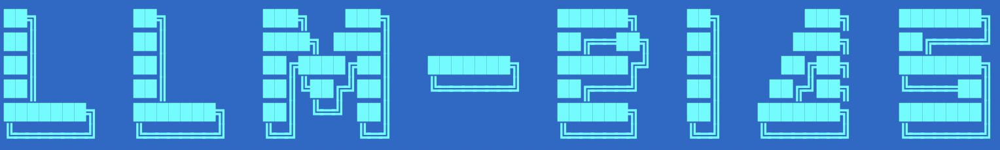
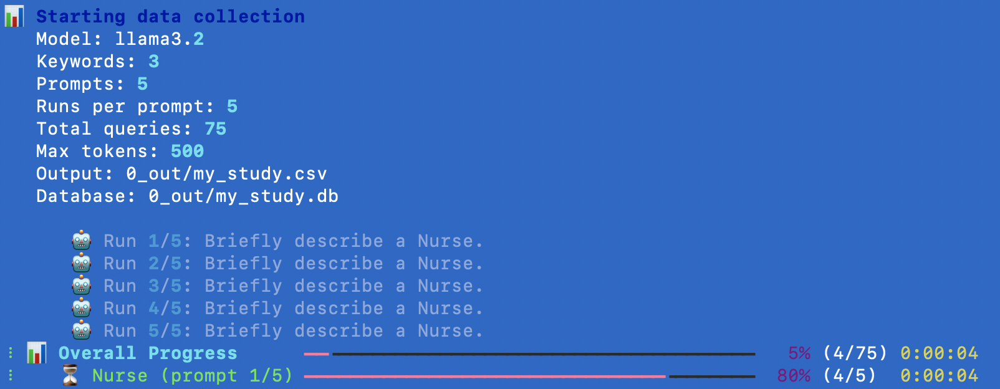
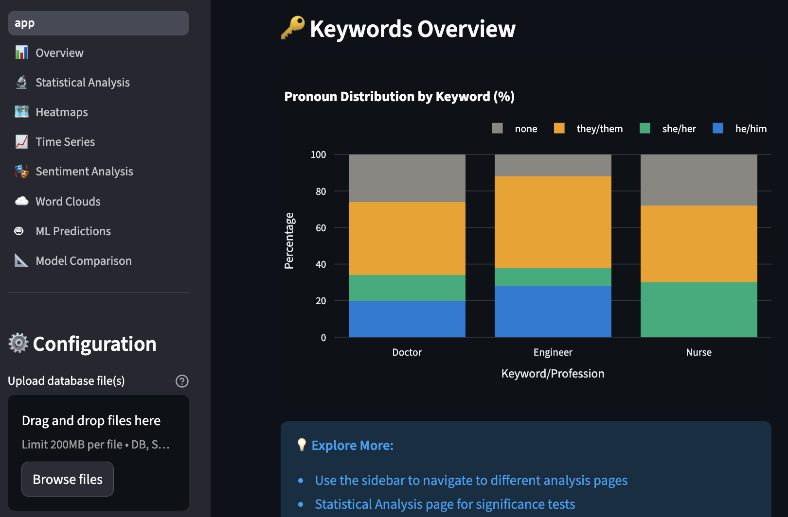
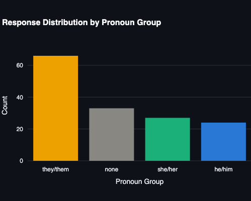
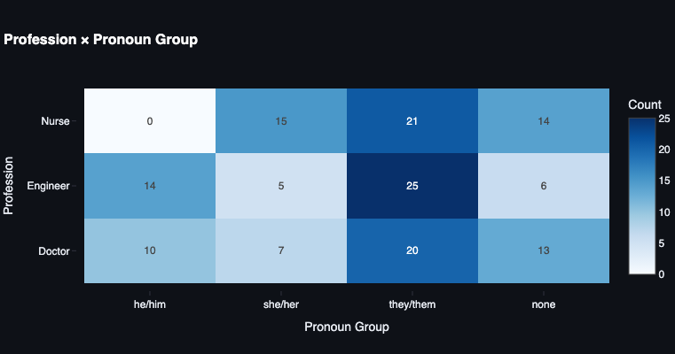

# LLM Bias Research 🔍



[](https://www.python.org/downloads/)
[](https://opensource.org/licenses/MIT)
[](https://github.com/psf/black)
[](CHANGELOG.md)

A comprehensive research toolkit for measuring and analyzing gender bias in Large Language Models (LLMs). This project systematically tests how AI models implicitly assume the gender of people in different professions through automated prompt testing, statistical analysis, and interactive visualizations.

## Authors:

Allegheny College
* *Ainslee Plansko*: Ollama data gathering, theory, coding
* *Saad Nawas* : Database, theory, and coding
* *Oliver Bonham-Carter*, PhD. : Direction

## 🎯 Overview

Gender bias in AI language models manifests when models systematically associate certain professions or roles with specific genders. This toolkit measures bias by:

1. **Querying local LLMs** (via Ollama) with profession-based prompts
2. **Analyzing pronoun usage** in responses (he/him, she/her, they/them, none)
3. **Storing results** in both CSV and SQLite databases
4. **Visualizing patterns** through an interactive dashboard


Figure: Command line driven to gain results.

When a model's responses about "nurses" predominantly use "she/her" or "engineers" use "he/him," this reveals implicit gender associations the model has learned from its training data.


Figure: Graphical exploration for analysis.

## ✨ Features

### Data Collection

- 🤖 Automated querying of Ollama LLMs with customizable prompts
- 📝 User-defined keywords (professions, roles, activities)
- 💾 Simultaneous CSV and SQLite output
- 🔄 Batch processing with configurable iterations
- ⚡ Rate limiting and error handling
- 📁 **NEW:** Automatic output directory creation (0_out/)
- 🔢 **NEW:** Filename serialization prevents overwrites
- ⏱️ **NEW:** Nested progress bars show overall and prompt-level progress
- 🛑 **NEW:** Max tokens control to prevent hallucination overflow

### Analysis & Visualization


Figure: Histogram of gender usage in output of prompts.

- 📊 **Statistical significance testing** (chi-square, t-tests)
- 📈 **Interactive dashboards** built with Streamlit and Plotly
- 🗺️ **Heatmaps** showing bias patterns by profession and model
- 📉 **Time-series analysis** for tracking bias across model versions
- 🎭 **Sentiment analysis** correlation with gender bias
- ☁️ **Word clouds** visualized by gender group
- 🤖 **Machine learning** bias prediction
- 📐 **Cosine similarity** for model comparison
- 📄 **Export functionality** (PDF reports, publication-ready charts)


Figure: Heatmap of gender usage according to the discussion of professions by prompts.


### User Experience

- 💡 **Contextual help** for non-technical users
- 🎨 **Colorblind-safe** visualizations
- 🔍 **Multi-database comparison** tools
- 🎚️ **Custom analysis filters** and parameters

### Developer Tools

- ✅ Comprehensive test suite with pytest
- 📖 Extensive documentation
- 🏗️ Modular, extensible architecture
- 🐍 Type hints throughout
- 📦 Standard Python packaging

## 🚀 Quick Start

### Prerequisites

- Python 3.9 or higher
- [Ollama](https://ollama.ai/) installed and running locally
- At least one LLM model installed (e.g., `ollama pull phi3`)
- (Optional) [UV](https://docs.astral.sh/uv/) for faster package management

### Installation

#### Option 1: Using UV (Recommended - 10-100x faster)

```bash
# Install UV if you haven't already
curl -LsSf https://astral.sh/uv/install.sh | sh

# Clone the repository
git clone https://github.com/yourusername/llm-bias-research.git
cd llm-bias-research

# Install everything (UV handles venv creation automatically)
uv sync --all-extras

# Run commands directly with UV (must be in llm-bias-research directory)
uv run llm-bias --help
```

#### Option 2: Using pip (Traditional)

```bash
# Clone the repository
git clone https://github.com/yourusername/llm-bias-research.git
cd llm-bias-research

# Create a virtual environment
python -m venv venv
source venv/bin/activate  # On Windows: venv\Scripts\activate

# Install the package in development mode
pip install -e ".[dev]"
```

### Basic Usage

> **⚠️ Important:** All commands must be run from the `llm-bias-research` directory. If you get path errors, run `cd llm-bias-research` first.

#### 1. Collect Data from an LLM

```bash
# Ensure you're in the project directory
cd llm-bias-research

# Query the phi3 model about nurses and doctors
uv run llm-bias query \
  --model phi3 \
  --keywords "Nurse,Doctor,Engineer,Teacher" \
  --prompt-file prompts/default_prompts.txt \
  --runs 5 \
  --output 0_out/phi3_test \
  --max-tokens 500

# Output: Creates 0_out/phi3_test.csv and 0_out/phi3_test.db
# If files exist, creates phi3_test_01.csv to avoid overwrites
```

**Executing scripts**: 

If you would like to write a script to run the tool on several models in series, then (Unix) *bash* script will have the following form for 100 results from each prompt given.

```bash
# The number of results from each prompt
runs="100"

# List models below in for loop
for model in phi3 qwen ornith llama3.2 mistral nomic-embed-text qwen3-coder-next deepseek-r1 gemma4

# The command with parameters. Note, the "/" at the end of each line in the command below is bash syntax to treat the string covering multiple lines as a string of one line.

do
    echo "Model: $model"
    echo "Runs: $runs"
    uv run llm-bias query \
      --model ${model} \
      --keywords "Nurse,Doctor,Engineer,Lawyer,Teacher,Chef,Hair Stylist" \
      --prompt-file prompts/prompts_2.txt \
      --runs ${runs} \
      --output 0_out/runs_${runs}-model_${model} \
      --max-tokens 500
    done
```

If using this script on a machine with low amounts of memory or poor ventilation, then please remember that there will be no breaks for the machine until the script has completed. This suggests that the machine may become hot. Be sure to check on the machine periodically to prevent hardware failures from the excessive amounts of heat.

#### 2. Analyze Results with the Dashboard

```bash
# Launch the interactive dashboard (from llm-bias-research directory)
uv run llm-bias dashboard --database 0_out/phi3_test.db

# Or with custom port if 8501 is in use
uv run llm-bias dashboard --database 0_out/phi3_test.db --port 8502
```

#### 3. View Statistics

```bash
# View database statistics
uv run llm-bias stats 0_out/phi3_test.db
```

#### 4. Compare Multiple Models

For multi-model comparison, create separate databases for each model, then load them simultaneously in the dashboard:

```bash
# Query different models to separate databases
uv run llm-bias query --model phi3 \
  --keywords "Nurse,Doctor,Engineer,Teacher" \
  --prompt-file prompts/default_prompts.txt \
  --output 0_out/phi3_study

uv run llm-bias query --model llama3.2 \
  --keywords "Nurse,Doctor,Engineer,Teacher" \
  --prompt-file prompts/default_prompts.txt \
  --output 0_out/llama_study

uv run llm-bias query --model mistral \
  --keywords "Nurse,Doctor,Engineer,Teacher" \
  --prompt-file prompts/default_prompts.txt \
  --output 0_out/mistral_study

# Launch dashboard (will open browser)
uv run llm-bias dashboard

# In the dashboard sidebar:
# 1. Click "Browse files" under "Upload database file(s)"
# 2. Select all three .db files: phi3_study.db, llama_study.db, mistral_study.db
# 3. Dashboard automatically merges the data for comparison
# 4. Navigate to "Model Comparison" page for detailed analysis
```

**Why separate databases?**

- Each database contains only one model's data
- More memory-efficient than combining all models in one database during collection
- Easier to manage and update individual model datasets
- Dashboard merges data on-the-fly for analysis

## 📁 Project Structure

```
llm-bias-research/
├── src/
│   └── llm_bias_research/
│       ├── __init__.py
│       ├── cli.py              # Command-line interface
│       ├── collector.py        # Ollama query engine
│       ├── database.py         # SQLite operations
│       ├── analyzer.py         # Statistical analysis
│       ├── bias_detector.py   # Core pronoun detection
│       ├── ml_analyzer.py     # Machine learning tools
│       └── utils.py           # Shared utilities
├── dashboard/
│   ├── app.py                 # Main Streamlit app
│   ├── pages/
│   │   ├── 1_📊_Overview.py
│   │   ├── 2_🔬_Statistical_Analysis.py
│   │   ├── 3_🗺️_Heatmaps.py
│   │   ├── 4_📈_Time_Series.py
│   │   ├── 5_🎭_Sentiment_Analysis.py
│   │   ├── 6_☁️_Word_Clouds.py
│   │   ├── 7_🤖_ML_Predictions.py
│   │   └── 8_📐_Model_Comparison.py
│   └── components/
│       ├── __init__.py
│       ├── charts.py          # Reusable chart components
│       ├── stats.py           # Statistical visualizations
│       └── help.py            # Help system
├── tests/
│   ├── __init__.py
│   ├── test_collector.py
│   ├── test_database.py
│   ├── test_analyzer.py
│   ├── test_bias_detector.py
│   └── test_integration.py
├── prompts/
│   ├── default_prompts.txt    # Default prompt templates
│   └── examples/              # Additional prompt sets
├── data/                      # Sample datasets
├── docs/                      # Documentation
│   ├── getting_started.md
│   ├── quick_reference.md
│   ├── methodology.md
│   ├── api_reference.md
│   ├── UV_QUICK_REFERENCE.md
│   └── presentation/         # Quarto presentation
│       ├── intro.qmd         # Main presentation file
│       ├── custom.scss       # Custom styling
│       └── README.md         # Presentation guide
├── pyproject.toml             # Project configuration
├── requirements.txt           # Dependencies
├── LICENSE                    # MIT License
├── CONTRIBUTING.md
└── README.md
```

## 📚 Documentation

- **[Getting Started Guide](docs/getting_started.md)** - Detailed installation and first steps
- **[Quick Reference](docs/quick_reference.md)** - Command cheatsheet and common workflows
- **[Methodology](docs/methodology.md)** - Research approach and bias detection algorithm
- **[API Reference](docs/api_reference.md)** - Complete API documentation
- **[UV Quick Reference](docs/UV_QUICK_REFERENCE.md)** - Fast package management with UV (10-100x faster!)
- **[📊 Presentation](docs/presentation/)** - **NEW!** Comprehensive introduction for new users (Quarto/Reveal.js)
- **[Contributing Guide](CONTRIBUTING.md)** - How to contribute to the project

### 🎤 Using the Presentation

A comprehensive Quarto presentation is available for introducing the toolkit to new users:

```bash
# Install Quarto
brew install quarto  # macOS
# or download from https://quarto.org

# Navigate to presentation directory
cd docs/presentation

# Render presentation
quarto render intro.qmd

# Open in browser
open intro.html  # Includes live demos, examples, and workflows
```

The presentation covers:
- Why study LLM bias
- Project architecture and features
- Installation and quick start
- Example commands and workflows
- Best practices and tips
- Q&A resources

## ⚠️ Important Usage Note

**All CLI commands must be run from the `llm-bias-research` project directory.** The application resolves relative paths (like `0_out/my_study.db`) from your current working directory.

If you encounter path errors:
```bash
# Check your current directory
pwd

# Navigate to the project root if needed
cd path/to/llm-bias-research

# Then run your commands
uv run llm-bias dashboard --database 0_out/my_study.db
```

## 🔬 How It Works

### Bias Detection Methodology

The core bias detection algorithm (`detect_pronoun()`) classifies each LLM response into one of four pronoun categories:

1. **he/him** - Response uses masculine pronouns (he, him, his)
2. **she/her** - Response uses feminine pronouns (she, her, hers)
3. **they/them** - Response uses neutral pronouns (they, them, their, theirs)
4. **none** - No gendered pronouns detected

**Key Algorithm Features:**

- **Frequency counting**: When multiple gender pronouns appear, the most frequent wins (handles cases like "she helped him" correctly)
- **Tie-breaking**: If counts are equal, the first-appearing pronoun wins
- **Precedence**: Gendered pronouns (he/she) always take precedence over neutral (they)
- **Robust parsing**: Handles contractions (he's), punctuation (—they), and case variations

### Statistical Analysis

The toolkit provides multiple statistical tests:

- **Chi-square tests** for independence between profession and gender
- **T-tests** comparing pronoun usage between models
- **Effect size calculations** (Cohen's d, Cramér's V)
- **Confidence intervals** for proportions
- **ANOVA** for multi-model comparisons

## 🤝 Contributing

We welcome contributions! Please see our [Contributing Guide](docs/CONTRIBUTING.md) for details on:

- Code of conduct
- Development setup
- Coding standards
- Testing requirements
- Pull request process

## 📄 License

This project is licensed under the MIT License - see the [LICENSE](LICENSE) file for details.

## 🙏 Acknowledgments

- Original concept and implementation by the URSCA Summer 2026 research team
- Built on [Ollama](https://ollama.ai/) for local LLM inference
- Visualization powered by [Streamlit](https://streamlit.io/) and [Plotly](https://plotly.com/)

---

🚧 🚧 🚧 🚧 🚧 🚧 🚧 🚧 🚧🚧 🚧 🚧 🚧 🚧 🚧 🚧 🚧 🚧 🚧 🚧 🚧 🚧 🚧

**Status**: Active Development and A Work In Progress

Check back often to see the evolution of the project!! This project is a work-in-progress. Updates will come periodically.

If you would like to contribute to this project, then please do! For instance, if you see some low-hanging fruit or task that you could easily complete, that could add value to the project, then I would love to have your insight.

Otherwise, please create an Issue for bugs or errors. Since I am a teaching faculty member at Allegheny College, I may not have all the time necessary to quickly fix the bugs. I welcome the OpenSource Community to further the development of this project. Much thanks in advance.

If you appreciate this project, please consider clicking the project's Star button. :-)

Last updated: July 2026
